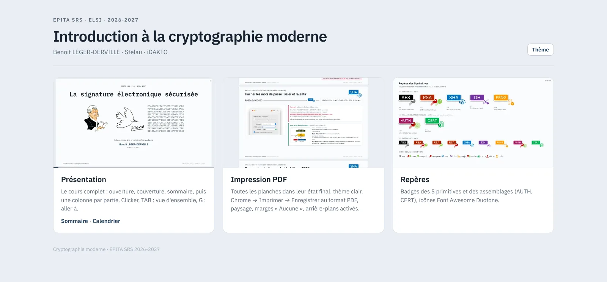
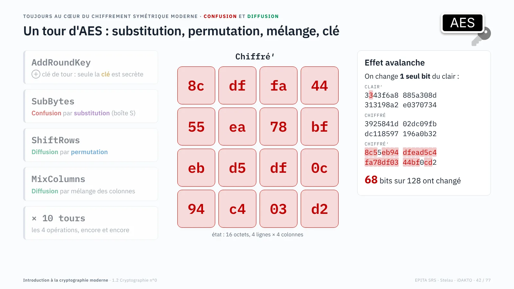
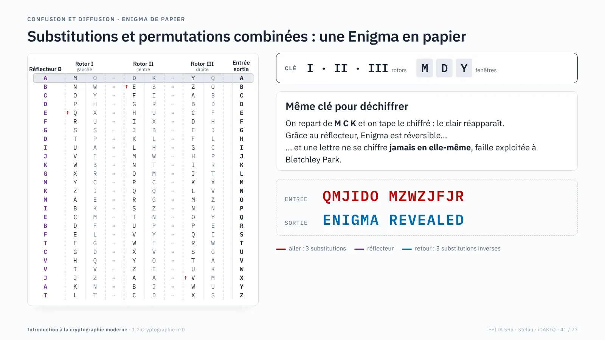
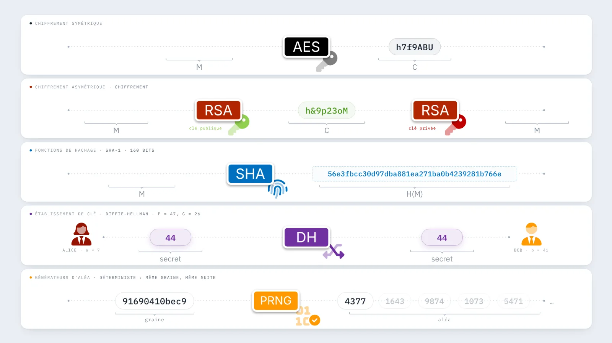
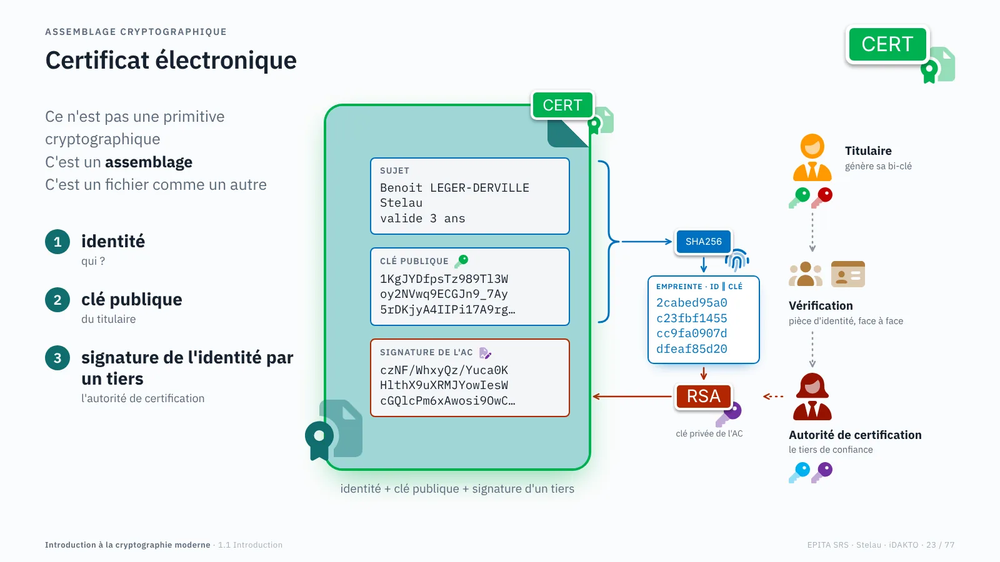
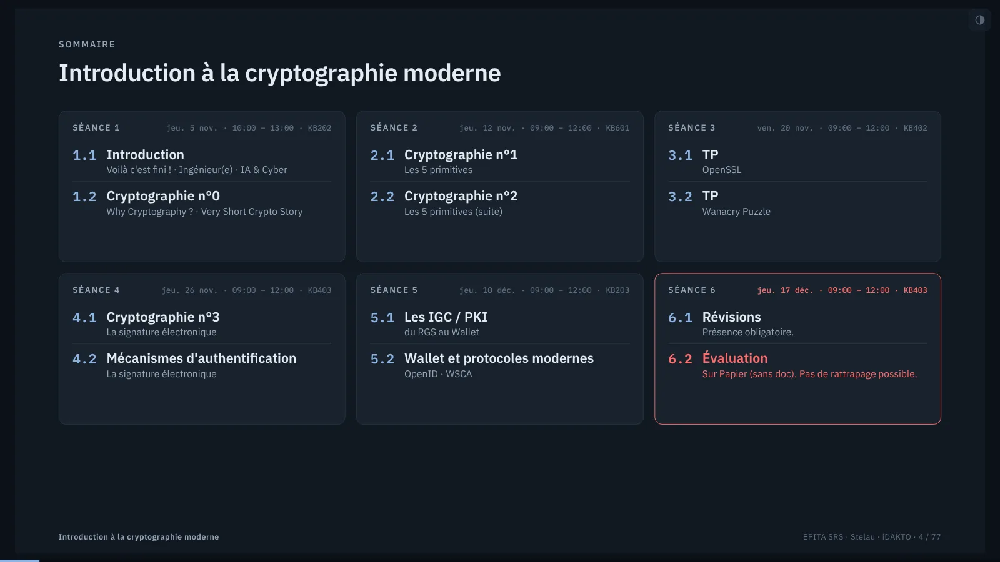

# Introduction à la cryptographie moderne

### [https://cours.stelau.com](https://cours.stelau.com)

**Le cours de Benoit LEGER-DERVILLE (Stelau · iDAKTO)** · EPITA SRS · 2026-2027

---

Ce dépôt contient **le cours tel qu'il est publié**. Il ne contient pas les sources : c'est le site statique produit
par la compilation du deck, mis à jour automatiquement à chaque modification du cours.

| Page                                                  | Contenu                                                                             |
| ----------------------------------------------------- | ----------------------------------------------------------------------------------- |
| [`index.html`](https://cours.stelau.com/)             | L'accueil : la présentation complète, une séance seule (3 h) ou la vue présentateur |
| [`cours.html`](https://cours.stelau.com/cours.html)   | Le deck : ouverture, sommaire, calendrier puis les séances, partie par partie       |
| [`badges.html`](https://cours.stelau.com/badges.html) | Les repères visuels des primitives (AES, RSA, SHA, DH, PRNG, AUTH, CERT)            |

## Le parti pris

Pas de captures d'écran figées : **la cryptographie se calcule en direct dans les planches**. Les chiffrés, les
empreintes, les sels et les clés sont réellement produits par le navigateur (AES-128 vérifié contre les vecteurs de
la FIPS-197, SHA, PBKDF2, Diffie-Hellman…), et chaque clic fait avancer le calcul sous les yeux de la salle.

<table>
  <tr>
    <td width="50%"></td>
    <td width="50%"></td>
  </tr>
  <tr>
    <td><b>Un tour d'AES</b>. AddRoundKey, SubBytes, ShiftRows et MixColumns animés sur l'exemple de la norme, puis
    l'effet avalanche : un bit du clair change et la moitié du chiffré bascule.</td>
    <td><b>Une Enigma en papier</b>. Rotors I, II, III et réflecteur B, clé MCK : on suit le trajet d'une lettre, puis
    on déchiffre <code>QMJIDO MZWZJFJR</code>.</td>
  </tr>
  <tr>
    <td></td>
    <td></td>
  </tr>
  <tr>
    <td><b>Le fil rouge des primitives</b>. Chiffrement symétrique et asymétrique, hachage, échange de clé et aléa,
    qui reviennent tout au long du cours.</td>
    <td><b>Le certificat électronique</b>. Pas une primitive mais un assemblage : identité, clé publique et
    signature d'un tiers de confiance.</td>
  </tr>
</table>

## Au programme

Six séances de trois heures, de l'histoire du chiffre aux portefeuilles d'identité numérique.

1. **Introduction** et **Cryptographie n°0** : pourquoi la cryptographie, une très courte histoire du chiffre
2. **Cryptographie n°1 et n°2** : les cinq primitives
3. **TP** : OpenSSL, puis l'énigme WannaCry
4. **Cryptographie n°3** et **mécanismes d'authentification** : la signature électronique
5. **IGC / PKI**, du RGS au wallet, et les protocoles modernes (OpenID, WSCA)
6. **Révisions** et **évaluation** sur papier

## En présentation

| Touche                                     | Effet                                                       |
| ------------------------------------------ | ----------------------------------------------------------- |
| <kbd>→</kbd> <kbd>Espace</kbd>             | Planche ou étape d'animation suivante                       |
| <kbd>Échap</kbd>                           | Vue d'ensemble, une colonne par partie                      |
| <kbd>Maj</kbd> + <kbd>↓</kbd> <kbd>↑</kbd> | Planche suivante ou précédente sans dérouler les animations |
| <kbd>S</kbd>                               | Vue présentateur : planche suivante, notes et chronomètre   |
| <kbd>P</kbd>                               | Pause des animations                                        |

Le thème clair ou sombre suit le système. Le bouton ◐ en haut à droite le force.

## Fabrication

Les planches sont écrites en HTML, CSS et JavaScript, une par dossier, et assemblées par
[reveal.js](https://revealjs.com) selon un manifeste par école. Les animations utilisent [GSAP](https://gsap.com). Le
site est construit avec Vite+, puis publié ici par une GitHub Action à chaque mise à jour des
sources, qui restent privées.

---

© Benoit LEGER-DERVILLE · <a href="https://stelau.com">Stelau</a>

